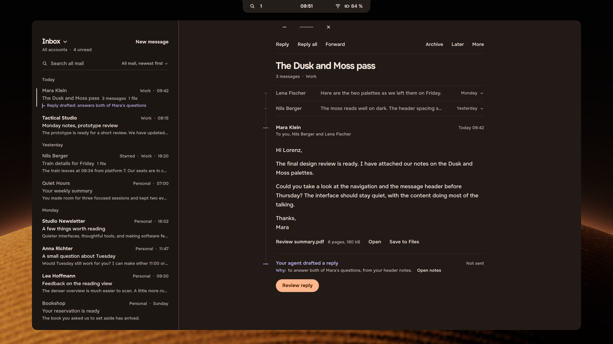

# Tacit Mail, design mock

A mail app drawn in Tacit's design language: every screen of the app, from adding an account to a send that failed
offline. It is a mock, not an app. Nothing here sends or reads mail. It shows what a Tacit mail client looks like and
how it behaves, for anyone building one.



[walkthrough.mp4](walkthrough.mp4) clicks through the main flow in 38 seconds: signing in, mail arriving, a thread,
the mailboxes, search, reviewing the agent's reply and sending it, a new message, and a notification.

## The screens

| Screen | Files |
|---|---|
| Reading a thread, with the agent's drafted reply | `read-*.png` (Dune, Ember and Emerald wallpapers) |
| Reviewing the agent's draft before sending | `draft-*.png` |
| The mailboxes beside the list | `switch-*.png` |
| A message with no agent draft | `plain-Dune.png` |
| Writing a new message | `compose-Dune.png` |
| Search | `search-Dune.png` |
| An empty mailbox | `empty-Dune.png` |
| Just after sending, with Undo in the notch | `sent-Dune.png` |
| Adding the first account (the provider's page in the notch) | `setup-Dune.png` |
| Mail arriving after setup | `importing-Dune.png` |
| Settings | `settings-Dune.png` |
| New mail as a notification | `notify-Dune.png` |
| A send that failed offline | `offline-Dune.png` |

## What it follows

- Dark only. The window sits on a dark ground, the shell (the notch) is frosted glass, and the accent colour comes from
  the wallpaper.
- Actions are words. The one decision on a screen may be a filled pill. No outlined buttons, boxed fields, shadows or
  cards: space and hairlines separate things.
- The agent's work is always marked (a small piece of the thread line in the agent's colour) and says why in one line.
  Nothing the agent prepares leaves until the person sends it, and a sent message can be undone for 10 seconds.
- You sign in on your provider's own page, held in the notch, so the mail app never sees your password.
- One signal per state, and everyday words in sentence case.

The values come from [Tacit's kit](https://github.com/ciscobugger/tacit-kit) and the design guide at
[design.tacitos.co](https://design.tacitos.co).

## Running it

`mail.qml` is a Quickshell file that runs inside Tacit's shell tree: it imports the shell's modules and `Tacit.Kit`,
which resolve from the top of the shell folder. Copy it there (the top of this repo, or `/usr/share/tacit/shell` on a
Tacit install) and draw one screen to a picture:

```sh
DUNE_SURFACE=read DUNE_WALL=/path/to/wallpaper.jpg DUNE_SHOT=$PWD/read.png qs -p /usr/share/tacit/shell/mail.qml
```

`DUNE_SURFACE` is one of `read draft switch plain compose search empty sent setup importing settings notify offline`.
The window is 1920 x 1080 (`DUNE_W`, `DUNE_H`); the picture is saved after 4.5 seconds and the mock quits.

## Notes

The people, addresses and messages are made up. The first sample content came from lorenz's mail prototype.

Part of [#44](https://github.com/ciscobugger/tacit/issues/44). GPL-3.0, like the rest of Tacit's source.
